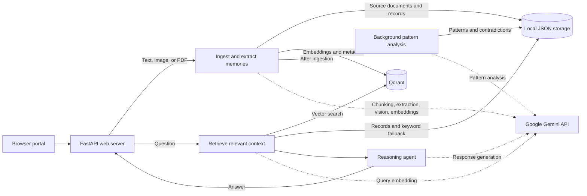

# Cognitive Memory OS

Cognitive Memory OS (CMOS) turns journal entries, diary scans, and PDFs into a searchable personal memory archive. Save what happened, then ask questions across entries to recall past decisions, revisit lessons, or reflect on recurring situations. The web portal combines ingestion, browsing, and chat in a single interface.

## Quick start

You need Docker with Compose v2, a Gemini API key, and internet access for Gemini requests. Put `.env` in the project root with the following entry. [Gemini API key setup](https://ai.google.dev/gemini-api/docs/api-key)

```dotenv
GEMINI_API_KEY=your_gemini_api_key
```

From the project root, create the persistent app volume and start the portal and Qdrant.

```sh
docker volume create learnings-agent-data
docker compose -f compose.app.yml up -d --build --wait
```

Open the [web portal](http://localhost:8000) or the [interactive API docs](http://localhost:8000/docs). The portal binds to the loopback interface by default.

## Use the portal

1. Choose **Paste Text** to enter a journal entry, or **Upload Image/PDF** to add a PDF or a PNG, JPG, JPEG, or WebP image. Add a date if you know when the entry happened.
2. Select **Save Experience** or **Upload & Process File**. CMOS extracts structured memories from the entry. Open **Stored Archives** to review the result.
3. Add more entries, then type a question under **Seek Guidance & Recall** and select **Ask Agent**. Details such as dates, activities, and decisions help the app retrieve relevant records.

For a first run, paste this sample entry, add a date, and ask, “What helped me feel better after a stressful workday?”

> I left a difficult meeting feeling tense. I took a 20-minute walk before replying to my messages. The walk helped me calm down and decide what to say.

After adding similar entries, try asking, “What tends to help me when I feel overwhelmed at work?” or “How have my decisions about taking on extra work changed over time?”

## Architecture



- **Ingestion.** The app uses selectable text from PDF pages when enough is available. It renders scanned or text-light pages as images and runs OCR, which also handles image uploads. The Docker image uses Tesseract. Gemini helps correct OCR, split text into passages, and extract structured memories with fields such as dates, emotions, and themes.
- **Storage and analysis.** JSON files hold source documents, extracted memories, and analysis records. Qdrant holds embeddings and retrieval metadata in the `semantic` and `emotional` collections. Successful web ingestion starts an in-process analysis task for recurring patterns and contradictions.
- **Recall.** The app searches Qdrant for relevant memories and loads the corresponding JSON records. When vector search is unavailable or yields no results, it scans local records for keywords. The reasoning agent builds a Gemini prompt from retrieved memories, relevant analysis, and recent conversation turns.

| Area | Source |
| --- | --- |
| Web portal and API | [`templates/index.html`](templates/index.html), [`web_server.py`](web_server.py) |
| Ingestion and query orchestration | [`orchestrator.py`](orchestrator.py) |
| PDF parsing, OCR, and extraction | [`pdf_parser.py`](pdf_parser.py), [`pipeline.py`](pipeline.py), [`extractor.py`](extractor.py) |
| Memory models, storage, and retrieval | [`models.py`](models.py), [`memory_repo.py`](memory_repo.py) |
| Analysis and reasoning | [`detector.py`](detector.py), [`agent.py`](agent.py), [`engine.py`](engine.py) |
| Container build and local stack | [`docker/Dockerfile`](docker/Dockerfile), [`compose.app.yml`](compose.app.yml) |

## Configuration and data

| Setting | Purpose |
| --- | --- |
| `GEMINI_API_KEY` | Runtime credential for Gemini requests. Set it in `.env`. |
| `CMOS_PORT` | Local portal port, which defaults to `8000`. Set it in `.env` if the port is already in use. |
| `CMOS_DATA_VOLUME` | Existing Docker volume mounted at `/app/data`. Defaults to `learnings-agent-data`. Create the named volume before starting Compose. |

Compose stores the JSON archive in `learnings-agent-data` and Qdrant data in a separate named volume. `docker compose -f compose.app.yml down` stops the stack and preserves both volumes. **Reset CMOS** deletes stored documents, memories, and analysis and clears the app's Qdrant collections.

CMOS is intended for local, single-user use. The web API has no login, and chat history is kept in the server process. Gemini requests can include journal text, scanned images, and retrieved context. Some text requests use the app’s PII masker, while the vision, chunking, and embedding paths can send original content. Use entries you’re comfortable sending to Gemini.

## API reference

| Method and path | Purpose |
| --- | --- |
| `GET /` | Open the browser portal. |
| `POST /api/ingest/text` | Save a JSON entry with `text` and an optional `date`. |
| `POST /api/ingest/file` | Upload a multipart `file` with an optional `date`. |
| `GET /api/memories` | List up to 50 stored memory records. |
| `POST /api/chat` | Ask a question using a JSON `message` field. |
| `POST /api/reset` | Delete stored app data and reset the app’s vector collections. |

## Docker publishing

The [GitHub Actions workflow](.github/workflows/docker-publish.yml) builds the `linux/amd64` image from [`docker/Dockerfile`](docker/Dockerfile) on pushes to `main` and updates `harshpatel22/learnings-agent:latest` on Docker Hub. Publishing uses the `DOCKERHUB_TOKEN` repository secret with Docker Hub read and write access. Each running Compose stack is updated separately.

To use the published image with the Compose stack, set up `.env` and the data volume as in the quick start, then run the following commands. Sign in to Docker Hub first if the image repository requires access.

```sh
docker pull harshpatel22/learnings-agent:latest
docker tag harshpatel22/learnings-agent:latest learnings-agent:latest
docker compose -f compose.app.yml up -d --no-build --wait
```

## Troubleshooting

| Symptom | What to check |
| --- | --- |
| The portal won’t open | Run `docker compose -f compose.app.yml ps` and `docker compose -f compose.app.yml logs api`. If port `8000` is in use, set `CMOS_PORT` to a free port and use that port in the browser. |
| Qdrant connection refused | Start the stack with `compose.app.yml` and check `docker compose -f compose.app.yml logs qdrant`. A standalone app container looks for Qdrant on its own localhost by default. |
| PaddleOCR unavailable | The Docker image uses the Tesseract fallback. Look for `Tesseract initialized as fallback` in the app logs. |
| Gemini requests fail | Check `GEMINI_API_KEY`, the project’s model access and quota, and the API logs. The portal can start before Gemini credentials are tested by a request. |
